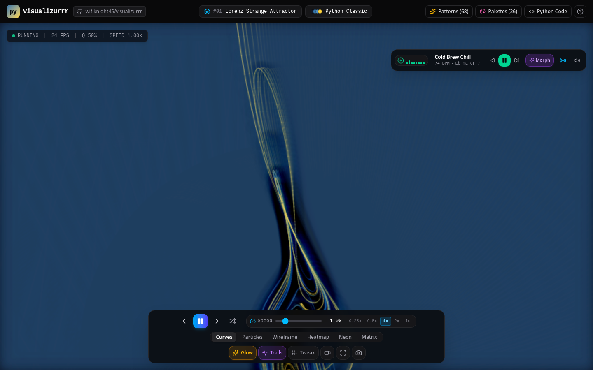

# visualizurrr

[](https://www.python.org/)
[](#core-features)
[](#core-features)
[](public/audio/CREDITS.md)
[](#how-to-use-via-bash)
[](LICENSE)
[](https://github.com/wifiknight45/visualizurrr/actions/workflows/ci.yml)
[](https://github.com/wifiknight45/visualizurrr/actions/workflows/pages.yml)

**Live demo:** https://wifiknight45.github.io/visualizurrr/


python algorithmic visualizer and open source lofi chill station


## Overview

visualizurrr is an interactive mathematical art and algorithmic pattern visualizer built for both modern web browsers and bash terminals. The application showcases sixty eight distinct mathematical patterns alongside twenty six curated color palettes, real time animation speed modulation, tactile controls and an audio reactive open source lofi chill sound engine that dynamically morphs visual patterns and color palettes to match musical phrasing and frequencies.


visualizurrr bundles eleven lofi tracks: seven by Holizna whose Creative Commons Zero status was verified track-by-track on Free Music Archive, plus the original four credited as CC0 (their source pages are still unverified — see public/audio/CREDITS.md for per-track credits, sources, and license status). The audio engine connects directly to Web Audio API frequency analysis nodes to drive visual reactivity without synthetic beeps.

1. High Quality Open Source Soundtracks
The station bundles eleven recordings — the original four:
Track one: Cold Brew Chill by RA. Smooth Rhodes electric piano, mellow acoustic drum groove, and relaxed downtempo swing in E flat major seventh.
Track two: Night in Kyoto by Avbe. Atmospheric nighttime Japanese chill hop with acoustic guitars and subtle vinyl texture in D minor ninth.
Track three: Moonshine Vibes by Prigida. Vintage analog tape saturation, warm bass-lines, and golden era hip hop beats in F major seventh.
Track four: Midnight Study Session by Lofi Records. Deep rain drenched acoustic piano chords with immersive low end warmth in C major seventh.

Plus seven CC0 tracks by Holizna (Free Music Archive, account HoliznaCC0), verified 2026-10-29:
Roof Tops and August Never Lasts (from Summer Air (Lo-Fi)) — sun-baked, nostalgic summer beats.
Ocean Memory and Currents We Used to Know (from Ocean Memory (Lo-Fi Chill)) — salt-air, slow-tide instrumentals.
Tokyo Sunset, One Night In France, and Bubbles (from Public Domain Lofi) — neon dusk, rainy café streets, and bright soda-pop fizz.

2. Controlling Playback
Click the play button inside the floating music player dock in the upper right corner of the screen. The animated vinyl disc spins while eight frequency spectrum bars dance in direct proportion to real time audio power. Use the skip buttons to move forward or backward between tracks, and use the volume slider or mute button to adjust listening levels.

3. Curated and Custom Chill Playlists
Clicking the track title or playlist icon opens the playlist modal. Users can select from prepackaged sessions such as Midnight Tokyo Lofi, Cosmic Study Session, or Coffee Shop Vinyl Beats. Users can also create a custom session: enter a session title, pick a vibe mood such as Late Night Focus or Celestial Slumber, and set a target tempo between 58 BPM and 85 BPM. A custom session re-presents the bundled library under your session name with suggested pattern and palette pairings for each track — it does not generate new recordings.

4. Audio Reactive Visual Mechanics
The Web Audio API analyzer extracts spectral metrics sixty times per second:
Sub Bass Frequencies: Kick drums and acoustic sub bass notes trigger instantaneous center scale bounces and rhythmic canvas breathing.
Mid Range Frequencies: Warm jazz piano chords and melodic riffs control continuous color palette hue cycles and wave ripples.
Treble Frequencies: Crisp hi hats and ambient room textures excite sparkling particle jitter and sharpen line contours.
Beat Transients: Percussive strikes trigger luminous bloom flares across the visual canvas.

5. Visual Audio Morphing
When the Morph button is active, visualizurrr synchronizes audio and visuals automatically. Each track change morphs the active mathematical pattern and color palette to the pairing suggested for that track. Morphing pauses for a minute after you pick a pattern or palette yourself, so it never overrides your choices.




## how to use via bash

git clone https://github.com/wifiknight45/visualizurrr.git
cd visualizurrr

Web app:

npm install
npm run dev        # development server
npm test           # unit + render smoke tests
npm run build      # production build in dist/

Terminal visualizer: see "Running in Bash Terminal" below.

All audio files inside public/audio are tracked and committed in git
history (~66 MB). Credits and license status: public/audio/CREDITS.md.

## Core Features

1. Sixty Eight Unique Aesthetic Patterns
The library contains mathematical equations spanning eight distinct categories:
Category one: Fractals and Strange Attractors including Lorenz, Mandelbrot, Julia, Barnsley Fern, Sierpinski, Rossler, Heighway Dragon, and Apollonian Circles.
Category two: Sacred Spirographs including Hypotrochoid, Epitrochoid, Maurer Rose, Lissajous Harmonograph, Phyllotaxis Sunflower, Metatrons Cube, Cardioid Caustics, and Archimedean Vortex.
Category three: Cellular Automata including Conways Game of Life, Wolfram Rule 30, Wolfram Rule 90, Wolfram Rule 110, Langtons Ant, Forest Fire Percolation, Brians Brain, and Cyclic Automata.
Category four: Physics and Wave Harmonics including Chladni Acoustic Plates, Double Pendulum Chaos, Fourier Epicycles, Wave Interference, Quantum Oscillators, Coupled Solitons, Magnetic Basins, and Gravitational N Body Orbits.
Category five: Vector Fields and Fluid Dynamics including Perlin Curl Noise, Clifford Attractors, De Jong Attractors, Svensson Attractors, Aizawa Tornadic Flow, Thomas Attractors, Karman Vortex Streets, and Diffusion Limited Aggregation.
Category six: Turtle Geometry and Lindenmayer Systems including Koch Snowflake, Hilbert Space Filling Curves, Gosper Flowsnakes, Peano Curves, Stochastic Trees, Starbursts, Polygonal Webs, and Cesaro Curves.
Category seven: Computational Optics and Geometry including Moire Gratings, Penrose P3 Quasicrystals, Voronoi Partitions, Delaunay Networks, Op Art Deformations, Tunnel Vortices, Four Dimensional Tesseracts, and Geodesic Domes.
Category eight: Organic Complex Systems including Gray Scott Morphogenesis, Boids Murmurations, Physarum Slime Mold Networks, Predator Prey Waves, Epidemic SIR Fronts, Dielectric Lightning, Jellyfish Pulses, Relativistic Starfields, Mandelbulb Slices, Ulam Spirals, Collatz Trees, and Fibonacci Spheres.


2. Twenty Six Predefined Color Palettes
The visualizer includes twenty six diverse palettes with names clearly displayed throughout the user interface:
Python Classic
Cyberpunk Neon
Synthwave 84
Viridis
Plasma
Magma
Inferno
Bioluminescence
Monokai Pro
Nord Frost and Aurora
Solarized Dark
Dracula Vampire
Tokyo Night
Sunset Horizon
Emerald Forest
Celestial Nebula
Golden Amber and Obsidian
Cherry Blossom
Electric Ultraviolet
Vaporwave Pastel
Laser Matrix
Deep Coral Reef
Blueprint Technical
Copper and Patina
Rainbow Spectrum
Monochrome Velvet


3. Real Time Speed Control
Users can adjust simulation velocity smoothly from very slow speeds like 0.05x up to rapid speeds like 6.0x using the tactile slider control or quick preset buttons.

4. Dual Runtime Architecture
The application runs as a high performance web application with sixty frames per second rendering and as a standalone Python script in bash terminals with twenty four bit truecolor graphics.


## Running in Bash Terminal

The Python script visualizurrr.py runs directly in standard bash environments with Python 3 (standard library only, nothing to install). Every one of the 68 patterns has its own real evaluator — escape-time fractals, integrated attractors, cellular automata, L-systems and more — rendered with 24-bit truecolor half-block graphics.

python3 visualizurrr.py                                  # Lorenz attractor, default palette
python3 visualizurrr.py --pattern julia --palette magma  # by id (or number, or full name)
python3 visualizurrr.py --pattern 2 --speed 2.5          # pattern number, faster
python3 visualizurrr.py --duration 0                     # run until Ctrl+C

python3 visualizurrr.py list-patterns                    # all 68 patterns
python3 visualizurrr.py list-palettes                    # all 26 palettes
python3 visualizurrr.py export my_lorenz.py --pattern lorenz
                                                         # standalone single-pattern script

Unknown patterns, palettes or out-of-range speeds exit with an error
message and a non-zero status. Rendering requires a terminal; the list
and export commands work anywhere.

## Web Application Commands and Shortcuts

Space key: Play or pause animation

Right Arrow: Next pattern

Left Arrow: Previous pattern

Up Arrow: Increase speed

Down Arrow: Decrease speed

C key: Cycle predefined color palette

R key: Randomize pattern and palette

M key: Cycle rendering mode between curves, particles, mesh, heatmap, neon, and matrix (each mode changes how every pattern is drawn)

G key: Toggle glow effect

T key: Toggle trail persistence

P key: Open Python code inspector

O key: Open full pattern explorer

S key: Save high resolution PNG image

F key: Presentation mode (fullscreen, controls hidden, patterns auto-advance every 18 seconds)

The control dock also records WebM video of the canvas. The URL hash always reflects the current pattern, palette, render mode, and speed, so links are shareable; your settings, per-pattern parameter tweaks, and any custom palettes you create in the palette picker persist in localStorage. Rendering quality adapts automatically if the frame rate drops.

## Architecture and Testing

The codebase enforces decoupled pure logic, unit tests, a render smoke test that executes all sixty eight patterns in every render mode, parameter-range validation across the whole pattern library, and audio engine validation. All tests run using the Node test runner via tsx:

npm test

Continuous integration (GitHub Actions) runs a clean install, the strict TypeScript check, the test suite, the production build, and Python byte-compilation checks for the terminal CLI on every push.

## mega_visualiser.py — windowed mega visualiser (companion script)

Alongside the terminal visualizer, this repo also includes mega_visualiser.py, a windowed visualiser built with NumPy and pygame. Where visualizurrr.py renders in the bash terminal, mega_visualiser.py renders in a real window with fractal noise detail, gradient lighting, bloom, and a post effects stack (pixelate, posterize, solarize, RGB shift, scanlines, film grain, neon edges).

It ships twenty nine modes — including fluid, fire, nebula, kaleidoscope, julia, mandelbrot, a live Gray-Scott reaction diffusion simulation with ten styles, and a two thousand two hundred particle flow field — crossed with sixty color palettes and thirty named presets: one thousand seven hundred forty base combinations before blending and live dials. Any two modes can be blended live (mix, add, screen, difference), any mode can be folded into a global kaleidoscope, and the noise texture can be re-seeded on the fly.

Run it from bash:

```bash
pip install numpy pygame pillow
python3 mega_visualiser.py
python3 mega_visualiser.py --preset hellfire
python3 mega_visualiser.py --mode julia --palette plasma
python3 mega_visualiser.py --list
```

Headless exports, no window needed (NumPy and Pillow only):

```bash
python3 mega_visualiser.py --still out.png --mode nebula
python3 mega_visualiser.py --gif out.gif --mode fluid --frames 48
python3 mega_visualiser.py --preview contact_sheet.png
```

In the window: press ? for the full key map, TAB cycles presets, hold the mouse to bend the field around the cursor, drag in reaction mode to seed new growth, hold in flowfield mode to attract particles, and press Y to start or stop GIF recording.

## License

Apache License 2.0 — see the LICENSE file in this repository.

## Changelog

Changes are recorded in CHANGELOG.md, updated after every verified
stage of work.
